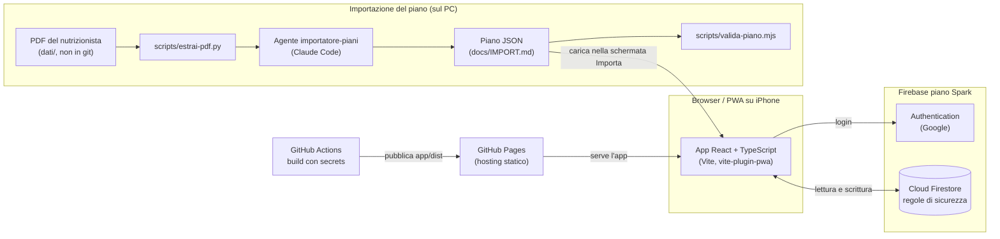

# PianoAlimentare

Segui il piano alimentare del tuo nutrizionista, un pasto alla volta.


[](https://github.com/PZero/PianoAlimentare/actions/workflows/pages.yml)

**App online:** <https://pzero.github.io/PianoAlimentare/> (accesso con Google; il primo accesso resta in attesa di approvazione).

> Il repository è **pubblico**. Non contiene dati personali reali: vedi [Privacy e dati](#privacy-e-dati).

---

## Indice

1. [Screenshot](#screenshot)
2. [Panoramica](#panoramica)
3. [Funzionalità](#funzionalità)
4. [Architettura](#architettura)
5. [Modello dati](#modello-dati)
6. [Installazione e avvio in locale](#installazione-e-avvio-in-locale)
7. [Test](#test)
8. [Deploy](#deploy)
9. [Struttura delle cartelle](#struttura-delle-cartelle)
10. [Stato del progetto e roadmap](#stato-del-progetto-e-roadmap)
11. [Privacy e dati](#privacy-e-dati)
12. [Contribuire](#contribuire)
13. [Licenza](#licenza)
14. [Autore](#autore)

---

## Screenshot

Gli screenshot arriveranno quando l'interfaccia sarà stabile. Useranno solo dati inventati, in `docs/screenshot/` (cartella non ancora presente).

---

## Panoramica

**Problema.** Il nutrizionista consegna il piano in un PDF di molte pagine, con pasti, alternative e liste della spesa. Nella vita quotidiana è scomodo capire cosa mangiare adesso e cosa comprare.

**A chi serve.** A chi segue un piano alimentare dato da un nutrizionista e vuole seguirlo con il telefono, soprattutto da iPhone.

**Cosa fa.**
- Importa il piano (file JSON ricavato dal PDF) e lo mostra in modo leggibile.
- Indica il prossimo pasto e registra se è stato fatto, sostituito o saltato.
- Fa scegliere le alternative previste dal piano, una volta a settimana.
- Prepara la spesa, su due canali: ordine Amazon e lista del fresco.
- Raccoglie il peso e lo mostra nel tempo, con un gioco pensato per premiare la costanza.

L'app **non genera piani**. Il piano è sempre quello del nutrizionista. I dettagli sono in [`docs/REQUISITI.md`](docs/REQUISITI.md).

---

## Funzionalità

### Accesso e utenti
- Login con Google (Firebase Authentication).
- Il primo accesso resta **in attesa** finché l'admin non lo approva.
- Profilo con nome e intolleranze (es. senza glutine), considerate nella scelta dei prodotti.
- Area **Admin**: elenco accessi in attesa, approvazione o blocco, importazione di un piano per un utente.

### Piano alimentare
- Importazione da file JSON, con schermata di controllo e correzione prima del salvataggio.
- Pasti con nomi e numero variabili da piano a piano (es. pre-allenamento, colazione, pranzo, spuntino, cena).
- Pasti a piatto fisso per giorno, pasti **liberi** e **digiuni**.
- Scelte del piano (gruppi di colazioni, ingredienti alternativi, varianti "in alternativa…") mostrate come scelte.
- Modifica del piano dopo l'import: nomi, quantità, unità, preparazioni, canale degli alimenti.
- Storico dei piani, con un piano attivo alla volta.
- Note e regole del nutrizionista mostrate come promemoria, con un indicatore sulle regole verificabili.

### Oggi e Settimana
- **Oggi**: piatto del prossimo pasto, ingredienti con grammature, preparazione.
- Stato di ogni pasto: *fatto*, *sostituito*, *saltato*.
- **Settimana**: vista dei sette giorni e scelte settimanali (es. ceci invece di lenticchie).

### Spesa (in arrivo)
- Ordine Amazon ogni 1-2 settimane: quantità dal piano e dalle scelte, convertite in confezioni, con link al carrello.
- Lista del fresco ogni 2-3 giorni, da spuntare, acquistata fuori da Amazon.
- Alimenti con link esterno segnalati come "da ordinare a parte".
- Ingredienti di base (olio, sale, spezie) esclusi. Legumi sempre già cotti.

### Peso (in arrivo)
- Inserimento del peso, grafico nel tempo, obiettivo.
- Gioco "Il Giardino" (concept da confermare): l'unica azione richiesta è inserire il peso; il gioco premia la costanza delle misure.

### Interfaccia
- PWA installabile dalla schermata Home di iOS e Android.
- Tema chiaro e scuro automatici, con i token del [design system](docs/DESIGN.md).
- Funzionamento offline per i dati già letti (cache locale di Firestore).

---

## Architettura



### Stack

| Area | Tecnologie |
|---|---|
| Interfaccia | React 19, TypeScript, Vite 8, vite-plugin-pwa |
| Test interfaccia | Vitest |
| Backend | Firebase Authentication, Cloud Firestore (piano Spark, nessuna Cloud Function) |
| Test regole | Emulatore Firestore, `@firebase/rules-unit-testing`, Vitest |
| Hosting | GitHub Pages, pubblicazione con GitHub Actions |
| Importazione | Python (`pypdf`, `pymupdf`), Node.js per il validatore |

### Flusso dei dati
1. Il nutrizionista consegna un PDF. Il file resta in locale, in `dati/`.
2. `scripts/estrai-pdf.py` estrae testo e pagine. L'agente `importatore-piani` produce il piano in JSON, secondo il formato di [`docs/IMPORT.md`](docs/IMPORT.md).
3. `scripts/valida-piano.mjs` controlla il JSON. I dubbi restano segnalati.
4. Nella schermata **Importa piano** l'utente controlla e corregge il piano, poi lo salva in `utenti/{uid}/piani`.
5. L'app legge e scrive solo i dati dell'utente autenticato. Firestore conserva una copia locale per l'uso offline.
6. Ogni push su `main` ricostruisce l'app con le variabili `VITE_FIREBASE_*` prese dai *secrets* di GitHub e la pubblica su GitHub Pages.

### Sicurezza
- La sicurezza sta nelle **regole Firestore**, non nell'interfaccia. Il principio è "tutto negato, salvo quanto elencato".
- Ogni utente legge e scrive solo sotto `utenti/{uid}`.
- Solo gli utenti con `stato = approvato` accedono alle proprie sottoraccolte. Gli utenti in attesa o bloccati non accedono a nulla.
- L'**admin** (documento con `ruolo = admin` e `stato = approvato`) approva gli accessi e può **creare** piani per altri, ma **non legge** i dati degli altri utenti.
- Il ruolo admin si assegna a mano dalla console Firebase. Nel codice non compare nessuna email.
- I campi di `diario` e `peso` sono validati (solo stati ammessi, peso tra 20 e 400 kg).
- Le regole complete e il contratto dati sono in [`firebase/firestore.rules`](firebase/firestore.rules) e [`docs/MODELLO-DATI.md`](docs/MODELLO-DATI.md).
- Le credenziali Firebase stanno in `.env` (escluso da git) o nei *secrets* di GitHub. Non sono nel codice.

---

## Modello dati

Firestore, con i documenti sotto `utenti/{uid}`:

| Percorso | Contenuto |
|---|---|
| `utenti/{uid}` | Profilo, stato di approvazione, ruolo, intolleranze, obiettivo peso |
| `utenti/{uid}/piani/{pianoId}` | Piano importato, con flag di piano attivo |
| `utenti/{uid}/settimane/{aaaa-Www}` | Scelte della settimana |
| `utenti/{uid}/prodotti/{alimentoId}` | Prodotto Amazon (ASIN, confezione), canale, link esterno, tag |
| `utenti/{uid}/diario/{aaaa-mm-gg}` | Stato di ogni pasto |
| `utenti/{uid}/peso/{aaaa-mm-gg}` | Peso in kg |
| `utenti/{uid}/spese/{id}` | Ordini Amazon e liste del fresco |

Schema completo, permessi per ruolo e fase 2 (nutrizionista): [`docs/MODELLO-DATI.md`](docs/MODELLO-DATI.md). Formato del piano importato: [`docs/IMPORT.md`](docs/IMPORT.md), con un esempio inventato in [`docs/esempi/piano-esempio.json`](docs/esempi/piano-esempio.json).

---

## Installazione e avvio in locale

### Requisiti
- Node.js 24 e npm (la stessa versione usata in CI).
- Git.
- Firebase CLI, installata globalmente: `npm install -g firebase-tools` (serve ai test delle regole).
- Java 21 (serve all'emulatore Firestore). Lo script di test cerca automaticamente l'installazione Adoptium 21 in `C:/Program Files/Eclipse Adoptium`.
- Python 3 con `pypdf` e `pymupdf`, solo per l'importazione dei PDF.
- Un progetto Firebase con Authentication (Google) e Firestore attivi. Il progetto usato è `piano-alimentare-pz`.

### Passi
1. **Clona il repository**
   ```bash
   git clone https://github.com/PZero/PianoAlimentare.git
   cd PianoAlimentare
   ```
2. **Crea il file `.env` nella radice del repository**, copiando il modello:
   ```bash
   cp .env.example .env
   ```
   Compila le sei variabili `VITE_FIREBASE_*` con i valori della configurazione web. Puoi leggerli con:
   ```bash
   firebase apps:sdkconfig WEB <appId> --project piano-alimentare-pz
   ```
   Il file `.env` non va mai committato: è escluso da `.gitignore`.
3. **Installa le dipendenze dell'app**
   ```bash
   cd app
   npm ci
   ```
4. **Avvia il server di sviluppo**
   ```bash
   npm run dev
   ```
   L'app è disponibile su <http://localhost:5173/PianoAlimentare/>.
5. **Primo accesso.** Accedi con Google. L'account resta in attesa. Per approvarlo, un admin lo approva dalla schermata **Admin**. Il primo admin si imposta a mano dalla console Firebase, con `ruolo = admin` e `stato = approvato` nel documento `utenti/{uid}`.
6. **Facoltativo: controlla un piano di esempio** con il validatore:
   ```bash
   node scripts/valida-piano.mjs docs/esempi/piano-esempio.json
   ```

Altri comandi utili, dalla cartella `app/`: `npm run build` (controllo TypeScript e build di produzione in `app/dist/`), `npm run preview`, `npm test`.

---

## Test

### Interfaccia (`app/`)
```bash
cd app
npm test
```
35 test con Vitest, in 4 file, sul dominio: date e calendario del piano, gestione del piano, calcolo delle quantità, validazione del formato piano.

### Regole Firestore (`firebase/`)
```bash
cd firebase
npm install
npm run test:rules
```
23 test sull'emulatore Firestore. Coprono: creazione del proprio profilo, divieto di auto-approvazione e di auto-promozione ad admin, poteri dell'admin (approva e blocca, crea piani per altri senza leggerli), accesso alle sottoraccolte in base allo stato di approvazione, validazione di peso, diario e piano, raccolte sconosciute negate.

### Validatore del piano
```bash
node scripts/valida-piano.mjs docs/esempi/piano-esempio.json
```
Controlla il JSON importato secondo [`docs/IMPORT.md`](docs/IMPORT.md).

### Integrazione continua
Il workflow [`pages.yml`](.github/workflows/pages.yml) esegue i test dell'interfaccia e la build prima di ogni pubblicazione. I test delle regole non sono ancora in CI (vedi roadmap).

---

## Deploy

### Hosting: GitHub Pages
- Il sito è pubblicato su <https://pzero.github.io/PianoAlimentare/> dal workflow [`.github/workflows/pages.yml`](.github/workflows/pages.yml).
- Ogni push su `main` esegue test, build e pubblicazione di `app/dist`. Il workflow può essere avviato anche a mano.
- Le sei variabili `VITE_FIREBASE_*` sono *secrets* del repository, mai scritti nel codice.
- In **Settings → Pages** la sorgente deve essere **GitHub Actions**.
- Firebase serve solo per Authentication e Firestore. Il sito non usa Firebase Hosting.

### Regole Firestore
```bash
cd firebase
npm run deploy:regole
```
Lo script lancia prima i test delle regole e poi `firebase deploy --only firestore` sul progetto `piano-alimentare-pz`. Gli indici sono in `firebase/firestore.indexes.json`.

**Stato:** le regole non sono ancora pubblicate. Vedi [Stato del progetto](#stato-del-progetto-e-roadmap).

---

## Struttura delle cartelle

```
PianoAlimentare/
├── .claude/              Agenti, comandi e configurazione per Claude Code
├── .github/workflows/    Pubblicazione su GitHub Pages (pages.yml)
├── app/                  Interfaccia: React, TypeScript, Vite, PWA
│   ├── public/           Icone e favicon
│   ├── scripts/          Generazione delle icone
│   └── src/
│       ├── domain/       Logica del piano, date, quantità, validazione (con test)
│       ├── data/         Firebase, sessione utente, accesso ai dati Firestore
│       └── ui/           Schermate e componenti
├── docs/                 Documentazione di progetto
│   ├── esempi/           Piano di esempio inventato
│   └── ...               Requisiti, modello dati, design, importazione, decisioni
├── firebase/             Regole Firestore, indici e test delle regole
├── scripts/              Estrazione dai PDF e validatore del piano
├── .env.example          Modello delle variabili Firebase (il file .env non è in git)
├── .firebaserc           Progetto Firebase predefinito
├── firebase.json         Configurazione Firestore ed emulatori
├── CHANGELOG.md          Modifiche per data
├── CLAUDE.md             Istruzioni per Claude Code
└── README.md             Questo file
```

La cartella `dati/` (PDF e piani reali) esiste solo in locale ed è esclusa da git.

---

## Stato del progetto e roadmap

### Fatto
- Requisiti, design system e modello dati.
- Autenticazione con Google e approvazione dell'admin.
- Regole Firestore con 23 test sull'emulatore.
- Schermate **Oggi**, **Settimana**, **Importa piano** (con controllo e correzione), **Modifica piano**, **Admin**, **Profilo**.
- Importazione dei piani: estrazione dal PDF, formato JSON, validatore.
- Pubblicazione automatica su GitHub Pages.

### In arrivo
- **Spesa**: ordine Amazon con link al carrello (ASIN) e lista del fresco.
- **Peso**: inserimento, grafico, obiettivo, gioco "Il Giardino".

### Fase 2
- Ruolo **nutrizionista**: codice di collegamento, il paziente sceglie quali dati condividere (piano, peso, diario, report) e può revocarli in ogni momento.
- Report per la visita successiva, calcolati nel client.

### Idee per dopo
- Promemoria tramite calendario `.ics` o Comandi rapidi di iOS.
- Dispensa con scorte e scadenze.
- Importazione di piani da altri nutrizionisti.

Le decisioni prese sono nel registro [`docs/DECISIONI.md`](docs/DECISIONI.md). Lo stato operativo è in [`docs/STATO.md`](docs/STATO.md).

---

## Privacy e dati

- Il repository è **pubblico**. Non contiene pasti, pesi, dati di salute, email o nomi reali.
- Esempi e test usano solo dati inventati, ad esempio [`docs/esempi/piano-esempio.json`](docs/esempi/piano-esempio.json).
- I PDF e i piani reali stanno in `dati/`, esclusa da git.
- Le credenziali stanno in `.env` (escluso da git) o nei *secrets* di GitHub.
- I dati degli utenti stanno in Firestore e sono accessibili solo al proprietario, come descritto in [Sicurezza](#sicurezza).

---

## Contribuire

Per segnalazioni e proposte, apri una *issue* su GitHub. Le modifiche al codice passano da una *Pull Request* verso `main`. Prima di ogni modifica, controlla che i test passino (vedi [Test](#test)) e che non ci siano segreti o dati personali nei file.

---

## Licenza

**Tutti i diritti riservati.** Il codice non è rilasciato con una licenza open source. Non è concesso riutilizzo, modifica o distribuzione senza autorizzazione dell'autore.

---

## Autore

**PZero** — [github.com/PZero](https://github.com/PZero)
